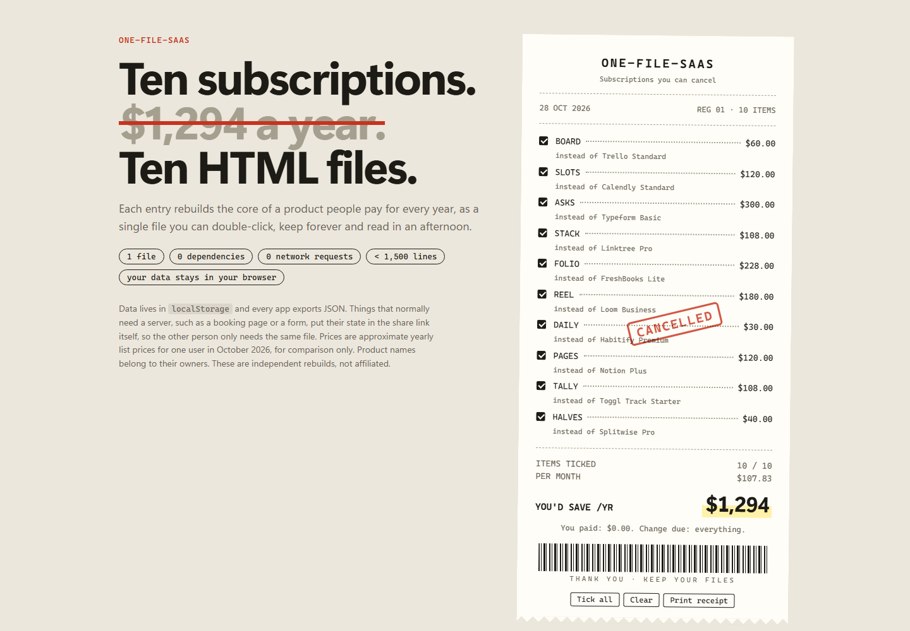

# one-file-saas

**Ten subscriptions. ~$1,294 a year. Ten HTML files.**

Each entry rebuilds the core workflow of a product people pay for every year, as one self-contained
HTML file. Double-click it and it runs. There is no install, no account and no server, and your data never leaves your browser.



Open [`index.html`](index.html) for the gallery. Tick the subscriptions you pay for today and the receipt
adds up what you'd stop paying.

## The shelf

| File | What it is | Instead of | ~ $/yr |
|---|---|---|---:|
| [`apps/kanban.html`](apps/kanban.html) | **Board**: kanban with drag and drop, labels, checklists, due dates, search | Trello Standard | 60 |
| [`apps/scheduler.html`](apps/scheduler.html) | **Slots**: booking page with weekly hours, buffers and an `.ics` invite for the guest | Calendly Standard | 120 |
| [`apps/forms.html`](apps/forms.html) | **Asks**: one-question-at-a-time forms, share link, responses with summaries and CSV | Typeform Basic | 300 |
| [`apps/link-in-bio.html`](apps/link-in-bio.html) | **Stack**: link-in-bio editor with themes and live phone preview; downloads a ~10 KB static page | Linktree Pro | 108 |
| [`apps/invoice.html`](apps/invoice.html) | **Folio**: invoices typed straight onto the page; taxes, discounts, clients, print to PDF | FreshBooks Lite | 228 |
| [`apps/recorder.html`](apps/recorder.html) | **Reel**: screen and camera-bubble recorder, pause, local library (IndexedDB), `.webm` download | Loom Business | 180 |
| [`apps/habits.html`](apps/habits.html) | **Daily**: habits with streaks, count goals, weekly targets, a year heatmap | Habitify Premium | 30 |
| [`apps/notes.html`](apps/notes.html) | **Pages**: nested pages, block editor with Markdown shortcuts, slash menu, Ctrl+K, Markdown export | Notion Plus | 120 |
| [`apps/pomodoro.html`](apps/pomodoro.html) | **Tally**: time tracker with projects, rates, weekly chart, Pomodoro mode, CSV | Toggl Track Starter | 108 |
| [`apps/splitter.html`](apps/splitter.html) | **Halves**: group expenses split equally, exactly, by percent or shares; cent-exact settle-up | Splitwise Pro | 40 |

Prices are approximate yearly list prices for one user in October 2026 and are for comparison only.
Product names belong to their owners. These are independent rebuilds with no affiliation.
The files total 5,000 lines including the gallery, and the largest is 576.

## How "no server" works

- **Your data** lives in `localStorage` (Reel stores video in IndexedDB). Every app has Export JSON and Import JSON,
  so moving to another browser or making a backup takes one file.
- **Sharing without a backend**: the state travels in the link.
  - **Slots** compresses your availability into `#book=…`. A guest picks a time, gets an `.ics` invite and sends you a short booking code.
  - **Asks** puts the whole form in `#fill=…`. Respondents finish with a response code that you paste into Responses.
  - Both work from any static host (GitHub Pages, Netlify drop) or from the file itself.
- **Publishing**: Stack downloads a JavaScript-free `index.html` for your link page. Folio prints to PDF through the browser.

These are not full replacements. There is no team sync, no email reminders and no payment collection.
They cover the part that one person actually uses every day.

## Rules for every file

1. One `.html` file. Inline CSS and JS only. No `<script src>`, no stylesheet links, no CDNs, no web fonts.
2. No network requests at runtime. Tests fail on any request that is not `file:`, `data:`, `blob:` or `about:`.
3. At most 1,500 lines, readable without a build step.
4. A header comment naming what it replaces, its storage key (`ofs.<app>.v1`) and the licence.
5. Export JSON, so the data is always yours.
6. A descriptive name of its own, not a trademark.
7. Light and dark mode via `prefers-color-scheme`, keyboard reachable, no console errors.

## Tests

```bash
npm install
```

```bash
npx playwright test
```

`tests/static.spec.js` enforces rules 1–5 for every file in `apps/` and for the gallery. Each app has a
headless smoke test that drives its main workflow and asserts zero console errors and zero external requests.
Timer apps use Playwright's fake clock, and the recorder uses Chromium's fake media devices.
28 tests run in about 15 seconds.

## Contributing

One SaaS per pull request: add `apps/<name>.html`, add a test in `tests/<name>.spec.js`, and add a line to the
`APPS` list in `index.html` with the product it replaces and its yearly price. Keep the file under the line budget.
Choose the workflow people actually pay for over feature parity.

## Licence

MIT
